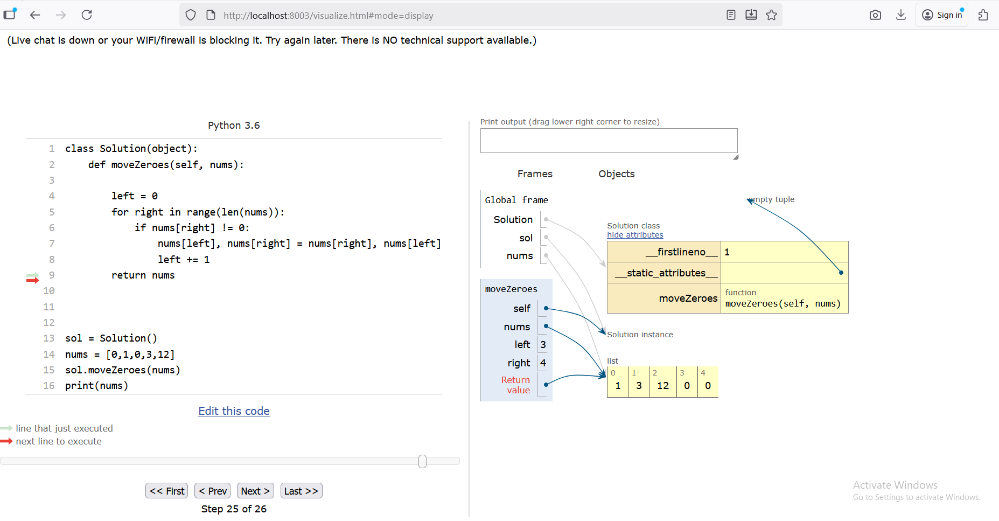

# Hi, I'm Grace Duquiza Olesen

**Computer Science | Software Engineering | Data Engineering**  
Aarhus, Denmark

I'm a final-year Bachelor of Science in Computer Science student at AMA University Online Education, focusing on full-stack development, software engineering, and data science.

I develop web and mobile applications, design REST APIs, work with relational databases, and deploy applications to cloud platforms. Before transitioning into technology, I built a background in sales, customer service, and hospitality across the Philippines, UAE, Denmark, and Norway. That experience continues to shape how I approach problem-solving and user-focused software.

**Career interests:** Software Engineering | Backend Development | Full-Stack Development | Data Engineering

### Connect

[Portfolio](https://graceduquiza.github.io/) | [LinkedIn](https://www.linkedin.com/in/graceduquizaolesen) | [Email](mailto:duquizaolesen@gmail.com)

---

## Featured Project

### Nutri-Tsek — Food Nutrition Evaluation Application

**Full-stack web and Android application | Computer Science thesis project**  
### [Nutri-Tsek](https://nutritsek.duquizaolesen.com/)

Nutri-Tsek helps consumers explore and compare the nutritional information of packaged food products through barcode scanning and product search. It presents multiple food evaluation indicators in one interface.

**Key features**

- Nutri-Score nutritional evaluation (A–E)
- NOVA food-processing classification
- Nordic Keyhole (Nøglehullet) assessment
- Nutritional traffic-light indicators
- Category-aware product comparison and product alternatives
- Nutrition goals, consumption tracking, and dashboard summaries
- English and Danish interface
- Guest access and authenticated features

**Technology stack:** Next.js, React, TypeScript, Tailwind CSS, ASP.NET Core (.NET 10), C#, PostgreSQL, Supabase, Redis, Azure, Vercel, Capacitor, Android, and ML Kit.

The project covers requirements analysis, system design, API development, database integration, authentication, testing, deployment, and ongoing improvements.

---

## Other Projects

### [Danish Vocabulary Trainer](https://graceduquiza.github.io/Danish_Vocab_Trainer/)

An interactive language-learning application with vocabulary flashcards, quizzes and grammar review for Danish learners.

**Tech:** JavaScript, HTML, CSS

### [Sudoku Learn](https://graceduquiza.github.io/SudokuGame/)

A responsive Sudoku game featuring hints, undo/redo, a timer, and multiple difficulty levels.

**Tech:** Vanilla JavaScript, HTML, CSS

### Online Python Tutor — Python 3.14 Fork

Modernized an existing open-source Python code visualization project for compatibility with Python 3.14.

**Contributions**

- Replaced deprecated `imp` functionality with `importlib`
- Resolved regular-expression warnings
- Removed exposed API keys
- Improved compatibility with newer Python versions

**Example output**

  
   
  <em>Figure 1. Example of code execution visualization in Online Python Tutor.</em>

### Folder Tree Viewer

A Flask-based utility that visualizes directory structures as Mermaid.js diagrams, making project architecture easier to inspect and explain.

**Features**

- Supports TD, LR, BT, and RL layouts
- Includes zoom controls and SVG export
- Excludes directories such as `node_modules`, `.venv`, and `__pycache__`

**Tech:** Python, Flask, JavaScript, Mermaid.js

**Example output**

  
   
  <em>Figure 2. Example of a folder structure diagram generated by Folder Tree Viewer.</em>

### [Siomai Cart Sarap](https://siomaisarap2828.web.app/)

A responsive menu website for a Filipino food business, built to present products and business information clearly.

**Tech:** HTML, CSS, JavaScript, Firebase

**Additional work in progress:** Sales Inventory App using React, Express.js, and PostgreSQL; backend security refinement ongoing.

---

## Research and Data Analysis

### Data Analyst Intern — Nightingale Project

**Johannes Gutenberg University Mainz | April–July 2025**

Worked with UK Biobank research data using Python for data preparation, statistical analysis, and visualization.

- Data cleaning, exploration, and analysis
- Correlation and regression analysis
- Scientific plots and documentation

**Tools:** Python, Pandas, NumPy, SciPy, Matplotlib, Jupyter Notebook

**Peer-reviewed publication:** [Research article — DOI: 10.21698/rjeec.2025.210](https://doi.org/10.21698/rjeec.2025.210)

---

## Technical Skills

| Category | Technologies |
| --- | --- |
| Programming | C#, Python, TypeScript, JavaScript, Java, C++, SQL |
| Frontend | React, Next.js, HTML, CSS, Tailwind CSS |
| Backend and APIs | ASP.NET Core, .NET, Node.js, Express.js, Flask, REST APIs |
| Databases | PostgreSQL, Supabase, SQLite, Oracle SQL |
| Data Analysis | Pandas, NumPy, SciPy, Matplotlib, Jupyter Notebook |
| Mobile | Capacitor, Android, ML Kit |
| Cloud and Deployment | Microsoft Azure, Vercel, Firebase, Railway, Render |
| Development Tools | Git, GitHub, Docker, Redis, Visual Studio, VS Code, PowerShell |
| Diagrams and Documentation | Mermaid.js, PlantUML, Draw.io |

**Additional interests:** Applied machine learning, AI-assisted development, and data-driven applications.

---

## Languages

- Hiligaynon — Native
- Filipino — Fluent
- English — Fluent
- Danish — PD3 certified; continuing to improve

---

I enjoy building practical software, learning new technologies, and improving applications through feedback and testing.

**Always learning, building, and improving.**
